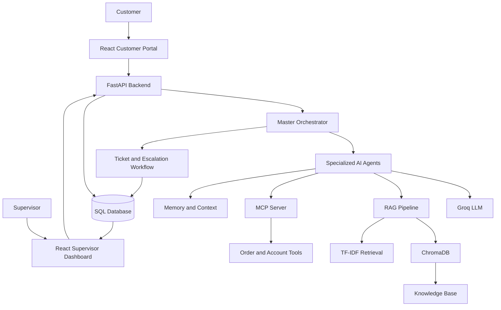
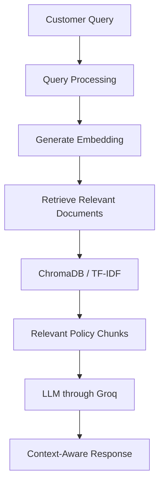
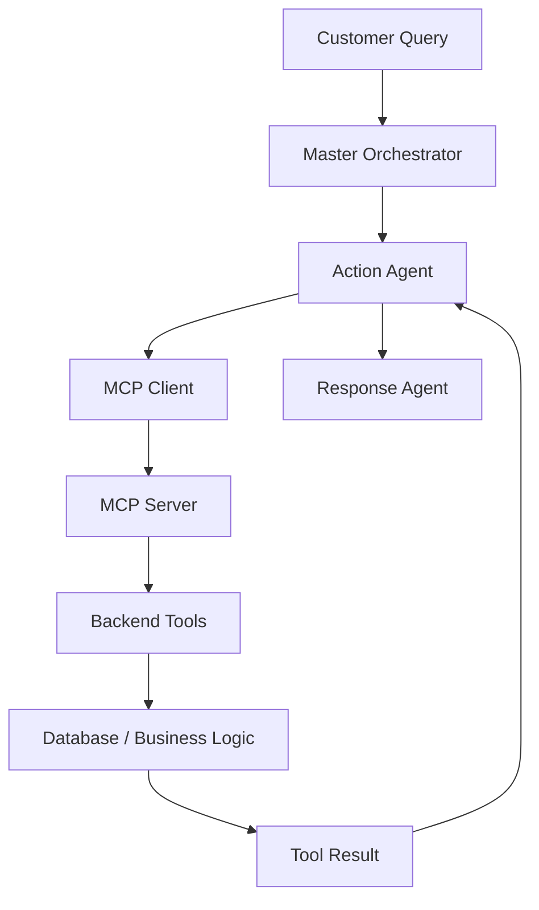
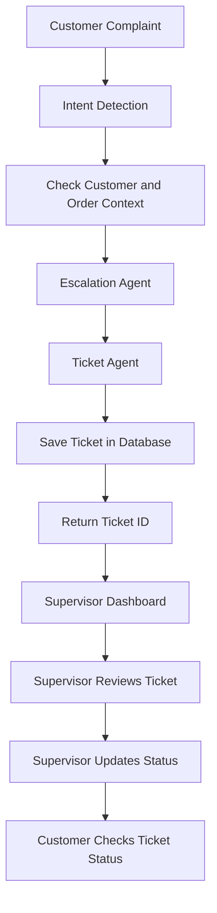

# AegisSupport – Agentic AI-Based Customer Support System

An intelligent, multi-agent customer support platform that automates customer query handling, order assistance, policy-based question answering, support ticket creation and escalation.

AegisSupport combines Large Language Models (LLMs), Retrieval-Augmented Generation (RAG), Model Context Protocol (MCP), and specialized AI agents to provide contextual and automated customer support through a web-based chatbot.

---

## 1. Project Overview

Traditional customer support systems often depend on human agents to handle repetitive queries related to orders, payments, refunds, returns and delivery issues. This can increase response time and create unnecessary workload for support teams.

**AegisSupport** aims to improve this process through an agentic AI architecture in which multiple specialized agents collaborate to understand customer queries, retrieve relevant information, execute supported operations and escalate unresolved issues to human supervisors.

The system provides two main interfaces:

- **Customer Portal:** Allows customers to interact with the AI chatbot, view their orders and raise support requests.
- **Supervisor Dashboard:** Allows support supervisors to view customer support tickets and update their status.

The backend coordinates the agents, manages customer data, retrieves knowledge-base information and communicates with external tools through MCP.

## 2. Objectives

- Build an AI-powered customer support chatbot.
- Implement a multi-agent architecture for specialized task handling.
- Use RAG to provide knowledge-based and policy-grounded answers.
- Integrate MCP tools for order and account-related operations.
- Maintain conversational context across customer interactions.
- Automatically create support tickets for issues requiring human intervention.
- Provide a supervisor dashboard for ticket management.
- Improve system efficiency using caching, indexing and performance optimization.
- Maintain customer authentication and role-based access control.

## 3. Key Features

### Customer Portal

- Customer authentication and login.
- AI-powered conversational support.
- Order lookup and order-status assistance.
- Payment issue guidance.
- Refund policy and eligibility assistance.
- Return and cancellation assistance through supported operations.
- Support ticket creation and escalation.
- Context-aware follow-up conversations.

### Supervisor Dashboard

- Supervisor authentication.
- View and monitor customer support tickets.
- Review ticket descriptions and customer information.
- Update ticket statuses.
- Track unresolved and resolved complaints.
- View dashboard analytics and system information.

### AI Capabilities

- Multi-agent query processing.
- Intent classification and routing.
- Conversation memory and context management.
- Knowledge-base retrieval using RAG.
- Tool execution through MCP.
- Automated ticket escalation.
- Response generation using an LLM.

## 4. Technology Stack

| Component | Technology |
|---|---|
| Frontend | React.js, TypeScript, Vite |
| UI Styling | Tailwind CSS |
| Backend | Python, FastAPI |
| Database | SQLAlchemy with SQLite/PostgreSQL support |
| LLM Integration | Groq API |
| AI Architecture | Multi-Agent System |
| Embeddings | HuggingFace Sentence Transformers |
| Vector Database | ChromaDB |
| Retrieval | Semantic Search and TF-IDF |
| Tool Integration | Model Context Protocol (MCP) |
| API Communication | REST APIs |
| Authentication | Customer and Supervisor Role-Based Authentication |
| Testing | Pytest, Frontend Production Build |

## 5. System Architecture

AegisSupport follows a modular client-server architecture.

### High-Level Architecture



### Architecture Explanation

1. The customer interacts with the React frontend.
2. The frontend sends the query to the FastAPI backend.
3. The Master Orchestrator coordinates the relevant specialized agents.
4. The agents classify the query and collect the required information.
5. The Knowledge Agent retrieves relevant policy documents when required.
6. The Action Agent invokes supported MCP tools for backend operations.
7. The Ticket and Escalation Agents handle complaints requiring human intervention.
8. The Response Agent prepares the customer-facing response.
9. The backend returns the response to the frontend.

The exact execution path depends on the customer's query. Not every agent needs to run for every request.

## 6. Multi-Agent Architecture

AegisSupport uses specialized agents, each responsible for a particular part of the customer-support workflow.

### 6.1 Master Orchestrator

The Master Orchestrator coordinates the overall agent workflow.

Responsibilities:
- Receives incoming customer queries.
- Coordinates specialized agents.
- Manages the execution flow.
- Passes information between agents.
- Determines which workflow should handle a query.

### 6.2 Guardrail Agent

Responsible for checking incoming queries and applying system restrictions.

Responsibilities:
- Identifies unsafe or inappropriate requests.
- Applies input restrictions.
- Helps prevent unauthorized or unsupported operations.

### 6.3 Intent Agent

Identifies the purpose of the customer's query.

Example intents:
- Order tracking.
- Payment issues.
- Refund requests.
- Return and replacement requests.
- Delayed delivery.
- Order cancellation.
- Ticket-status queries.
- Account-related issues.

The detected intent helps the orchestrator select the appropriate workflow.

### 6.4 Memory Agent

Maintains relevant information from previous customer interactions.

Responsibilities:
- Retains conversation history and relevant references.
- Tracks selected order IDs and ticket IDs.
- Supports follow-up questions.
- Helps resolve references such as "that order", "my complaint" and "any update?"
- Maintains context associated with the customer conversation.

### 6.5 Context Agent

Collects and prepares relevant information required to answer the current query.

Responsibilities:
- Retrieves relevant customer information.
- Collects order and ticket details.
- Uses information maintained by the Memory Agent.
- Combines conversation history with current query information.
- Prepares relevant context for downstream agents.
- Helps distinguish order status from ticket status.

**Difference between Memory and Context:**

- Memory Agent remembers relevant information from previous interactions.
- Context Agent identifies, verifies and combines the information needed for the current query.

### 6.6 Knowledge / RAG Agent

Responsible for retrieving relevant information from the knowledge base.

Responsibilities:
- Processes customer queries.
- Retrieves relevant policy documents.
- Uses semantic retrieval and TF-IDF-based retrieval.
- Supplies relevant context to the LLM.

### 6.7 Planner Agent

Determines the next steps required to solve a customer query.

Responsibilities:
- Selects the appropriate workflow.
- Determines whether an information lookup or tool execution is needed.
- Coordinates the required actions.

### 6.8 Reviewer Agent

Reviews proposed responses and actions.

Responsibilities:
- Checks response relevance.
- Verifies that responses follow available policies.
- Helps prevent unsupported claims.
- Reviews whether an action has sufficient information and authorization.

### 6.9 Action / MCP Agent

Connects the agent workflow to backend operations using Model Context Protocol.

Responsibilities:
- Invokes supported MCP tools.
- Retrieves order and account information.
- Checks refund eligibility.
- Initiates supported return or cancellation operations.

### 6.10 Escalation Agent

Identifies customer issues that require human intervention.

Examples:
- Unresolved complaints.
- Damaged or incorrect products requiring review.
- Delayed deliveries requiring investigation.
- Payment problems that cannot be resolved automatically.
- Explicit requests to speak to human support.

### 6.11 Ticket Agent

Responsible for support ticket creation and management.

Responsibilities:
- Creates support tickets for eligible complaints.
- Stores ticket information in the database.
- Associates tickets with the relevant customer and order.
- Returns ticket identifiers.
- Supports ticket-status retrieval through the relevant workflow.

### 6.12 Response Agent

Generates the final response presented to the customer.

Responsibilities:
- Combines information from relevant agents.
- Uses retrieved policy and operational information.
- Generates clear, customer-friendly responses.
- Communicates action results and ticket information.

## 7. Retrieval-Augmented Generation (RAG)

### What is RAG?

Retrieval-Augmented Generation is a technique in which relevant information is retrieved from an external knowledge source and supplied to an LLM before it generates a response.

Instead of relying entirely on the LLM's pre-trained knowledge, the system uses project-specific support documents to generate more relevant answers.

### RAG Implementation in AegisSupport

The Knowledge Agent uses:

- HuggingFace Sentence Transformers for generating text embeddings.
- ChromaDB for vector-based document retrieval.
- TF-IDF for keyword-based retrieval.
- Groq for LLM inference.

### RAG Workflow



### Example Knowledge-Base Documents

| Document ID | Topic |
|---|---|
| KB-101 | Wrong or damaged item |
| KB-102 | Payment debited but order failed |
| KB-103 | Account locked or login failure |
| KB-104 | Subscription inactive |
| KB-105 | Order cancellation rules |
| KB-107 | Delayed shipment and tracking |
| KB-108 | Refund eligibility and timelines |
| KB-110 | Coupon and discount issues |

### Example

Customer query:

"My money was deducted but my order was not placed."

The Knowledge Agent retrieves KB-102, which contains the relevant payment-failure policy.

The retrieved information is passed to the LLM as context to help generate an appropriate response.

**Benefits of RAG:**
- Uses project-specific information.
- Reduces reliance on unsupported model knowledge.
- Provides policy-grounded responses.
- Allows the knowledge base to be updated independently of the LLM.

## 8. Model Context Protocol (MCP)

### What is MCP?

Model Context Protocol is a standard for connecting AI applications and agents with external tools and data sources.

In AegisSupport, MCP allows the Action Agent to invoke supported backend operations.

### MCP Tools Implemented

| MCP Tool | Purpose |
|---|---|
| `lookup_order` | Retrieves order information. |
| `refund_eligibility` | Checks refund eligibility based on available order and policy information. |
| `request_return` | Initiates a supported return request. |
| `cancel_eligible_order` | Cancels an order when it satisfies cancellation conditions. |
| `account_status` | Retrieves account-related status information. |

### MCP Workflow



### Example

Customer:

"What is the status of my order ORD33410?"

1. Intent Agent identifies an order-status query.
2. Action Agent selects the order lookup tool.
3. MCP invokes `lookup_order`.
4. Backend retrieves the order information.
5. The result is passed to the Response Agent.
6. The chatbot presents the order status.

**Important:** MCP tool execution does not automatically mean that a refund has been transferred or a replacement has been completed. Only operations actually supported and confirmed by the backend should be reported as successful.

The MCP server is launched or connected by the application's Action Agent workflow; it does not normally need to be started manually as a separate terminal process.

## 9. Conversation Memory and Context Management

Conversation memory is important because customers often ask follow-up questions without repeating the order or ticket ID.

Example conversation:

```text
Customer:
My order ORD33410 has not been delivered after the expected date.

Aegis AI:
Your support ticket has been created.

Customer:
What's the status now?

Expected:
The chatbot identifies the ticket created in the
previous interaction and retrieves its latest status.
```

The Memory and Context Agents are intended to work together to maintain relevant references.

A structured conversation context can contain:

- Customer ID.
- Conversation ID.
- Current intent.
- Previous intent.
- Selected order ID.
- Selected ticket ID.
- Active issue category.
- Pending clarification.
- Relevant conversation history.

The Context Agent uses this information to prepare the context for the current request.

**Implementation validation:** Conversation continuity, follow-up ticket lookup, topic changes and persistence across refreshed sessions must be tested end to end. Passing isolated agent tests does not by itself prove that the React frontend, backend and agents correctly propagate the same conversation context.

## 10. Ticket Creation and Escalation Workflow

AegisSupport supports escalation of customer issues that require human intervention.

### Example Escalation Scenarios

- Customer reports a damaged product.
- Customer reports an unresolved payment issue.
- Customer reports a delayed delivery.
- Customer requests human support.
- Customer has an unresolved complaint.

### Ticket Workflow



### Ticket Status Management

The project supports ticket status management through the supervisor workflow.

Statuses include the following where configured:

- Opened
- Assigned
- Pending Customer
- In Progress
- Resolved
- Closed

When a supervisor updates a ticket, the latest status should be retrieved from the database when the customer asks for an update.

A ticket-status query should use ticket context rather than incorrectly treating the query as an order cancellation or general policy question.

## 11. Authentication and Security

AegisSupport uses separate customer and supervisor authentication flows.

Security features include:

- Customer authentication.
- Supervisor authentication.
- Role-based access control.
- Customer-specific order access.
- Customer-specific ticket access.
- Authorization checks before accessing protected resources.
- Protection of sensitive information in logs.

Customers should only be able to access their own orders and tickets.

Supervisor operations must be protected by supervisor authorization.


## 12. Performance Optimization

Several optimization techniques have been implemented or introduced to improve backend and retrieval performance.

### 12.1 TF-IDF Index Reuse

The TF-IDF retrieval index is reused instead of rebuilding it for every query.

**Benefit:** Reduces repeated computation and retrieval overhead.

### 12.2 RAG Caching

A bounded TTL/LRU cache stores recently retrieved results.

- TTL (Time To Live) controls how long an entry remains valid.
- LRU (Least Recently Used) removes older, less frequently used entries when the cache reaches its limit.

**Benefit:** Avoids unnecessary repeated retrieval operations.

### 12.3 Deterministic Intent Routing

Rule-based routing handles supported and predictable query patterns.

**Benefit:** Reduces unnecessary LLM calls for straightforward queries.

### 12.4 LLM Timeout and Retry

Timeout handling, retry mechanisms and bounded concurrency are used for LLM requests.

**Benefit:** Improves reliability and prevents requests from hanging indefinitely.

### 12.5 Database Connection Pooling

Database connections are reused through connection pooling.

**Benefit:** Reduces connection overhead and improves database efficiency.

### 12.6 Performance Monitoring

The backend collects performance metrics through a protected `/api/metrics` endpoint.

Metrics include:

- HTTP request counts.
- HTTP failures.
- Database query duration.
- RAG retrieval duration.
- LLM inference duration.
- Cache hits and misses.
- Intent-routing counters.

Sensitive customer content and secrets should not be included in metrics or logs.

### 12.7 RAG Benchmark Results

A local retrieval benchmark reported the following results:

| Metric | Before Optimization | After Optimization |
|---|---:|---:|
| Average RAG retrieval latency | 2.943 ms | 0.181 ms |
| Top-K retrieval exact-match parity | — | 100% |

Reported improvement:

- Approximately 16.2× faster retrieval.
- Approximately 93.9% lower retrieval latency.
- 100% top-K retrieval exact-match parity.

Benchmark configuration:
- 48 benchmark requests.
- 8 workers.
- Controlled local retrieval benchmark.

**Note:** These results measure RAG retrieval performance, not the total end-to-end chatbot response time. They should not be interpreted as a 16.2× improvement in complete customer response time.

## 13. Performance Monitoring API

The backend exposes a protected endpoint:

```http
GET /api/metrics
```

It provides performance information such as:

- Request and failure counters.
- Database query timings.
- Retrieval timings.
- LLM inference timings.
- Cache statistics.

The endpoint requires appropriate supervisor authorization.

The health endpoint is:

```http
GET /api/health
```

## 14. Project Directory Structure

The project is organized into separate frontend and backend applications.

A simplified structural overview:

```text
AegisSupport/
│
├── backend/
│   ├── main.py
│   ├── requirements.txt
│   ├── .env
│   ├── agent modules/
│   ├── MCP server and tools/
│   ├── RAG and retrieval modules/
│   ├── database and models/
│   ├── API routes/
│   ├── services/
│   └── tests/
│
├── frontend/
│   ├── package.json
│   ├── src/
│   │   ├── components/
│   │   ├── pages/
│   │   ├── services/
│   │   └── application files
│   └── public/
│
└── README.md
```

This is a logical overview, not an exhaustive file listing. Refer to the actual project directories for exact module and filename locations.

## 15. Installation and Setup

### Prerequisites

Install the following:

- Python.
- Node.js and npm.
- Git.
- A Groq API key.
- Required database configuration.

### Step 1: Clone the Repository

```bash
git clone <YOUR_REPOSITORY_URL>
cd AegisSupport
```

Replace the repository URL and directory name with the actual values used in your GitHub repository.

### Step 2: Backend Setup

Open a terminal and navigate to the backend:

```bash
cd backend
```

Create a virtual environment if one does not already exist:

```bash
python -m venv .venv
```

Activate it on Windows:

```cmd
.venv\Scripts\activate
```

Install the backend dependencies:

```bash
pip install -r requirements.txt
```

### Step 3: Configure Environment Variables

Create a `.env` file in the location expected by the backend configuration.

Use the project's `.env.example` if available.

Configure the required values, such as:

- Groq API key.
- Database configuration.
- Authentication and secret configuration.
- Supervisor login configuration.
- Optional SMTP configuration.

The supervisor credential variable names used by the project include:

```env
SUPERVISOR_EMAIL=
SUPERVISOR_PASSWORD=
```

Use the exact variable names and configuration format expected by the current source code.

Never commit actual credentials or API keys.

### Step 4: Start the Backend

Run from the backend directory:

```bash
python -m uvicorn main:app --reload --port 8001
```

Backend URL:

```text
http://localhost:8001
```

API documentation:

```text
http://localhost:8001/docs
```

Health check:

```text
http://localhost:8001/api/health
```

### Step 5: Frontend Setup

Open a second terminal:

```bash
cd frontend
```

Install dependencies:

```bash
npm install
```

Start the React development server:

```bash
npm run dev
```

The frontend commonly runs at:

```text
http://localhost:5174
```

If the port is already occupied, Vite may select another available port.

Configure the frontend API base URL according to the project's environment configuration.

### Step 6: Run the Application

Keep both terminals running:

- Backend: Port 8001.
- Frontend: Port 5174, or the port reported by Vite.

Open the frontend URL in your browser.

The Action Agent manages its MCP server connection as part of the application workflow. A separate manual MCP startup is normally unnecessary.

## 16. Demo Login

The project contains demo customer data for testing.

Example customer login:

```text
Email: aarav@example.test
Password: Demo@12345
```

Example customer ID:

```text
C001
```

These are demo credentials only. Supervisor credentials should be configured through the backend environment variables.

Do not use demo credentials for a public production deployment.

## 17. Example Customer Queries

The following queries can be used to demonstrate the system's different workflows.

### Order Tracking

```text
What is the status of my order?
Track my order ORD33410.
When will my order be delivered?
```

### Payment Issues

```text
My money was deducted but my order was not placed.
My payment failed.
I was charged twice for the same order.
```

### Refund Assistance

```text
What is your refund policy?
Am I eligible for a refund?
My refund has not arrived.
```

### Return and Replacement

```text
I want to return my product.
I received a damaged product.
I want to replace my order.
```

### Delivery Complaints

```text
My order has not been delivered after the expected date.
My shipment is delayed.
```

### Ticket Escalation

```text
I want to speak to a human supervisor.
My issue is still unresolved.
Please escalate my complaint.
```

### Ticket Status

```text
What is the status of my ticket?
Any update on my complaint?
Has my issue been resolved?
```

For follow-up queries without an explicit ticket ID, the application must correctly identify the relevant ticket using conversation context.

## 18. Testing

### Backend Tests

Navigate to the backend directory and activate the virtual environment.

Run:

```bash
python -m pytest -q
```

### Frontend Production Build

Navigate to the frontend directory and run:

```bash
npm run build
```

On Windows CMD, this can also be run as:

```cmd
npm.cmd run build
```

### Important End-to-End Test Scenarios

1. Customer login and authentication.
2. Order lookup and ownership verification.
3. Payment-related queries.
4. RAG policy retrieval.
5. MCP tool execution.
6. Return and cancellation workflows.
7. Ticket creation and escalation.
8. Supervisor ticket-status updates.
9. Customer ticket-status lookup.
10. Conversation memory and follow-up queries.
11. Multiple customers and multiple tickets.
12. Unauthorized access prevention.

Unit tests alone are insufficient for validating agent coordination. Important workflows should also be tested through the actual React chatbot and backend APIs.

## 19. Limitations and Future Scope

The current system is a demonstration and academic implementation. The following points should be considered before production use.

### Current Limitations

- Actual refund transfers are not performed; refund eligibility checks are supported.
- Replacement processing should not be claimed as an automatic operation unless a dedicated replacement action is implemented and confirmed.
- Email notifications depend on SMTP configuration.
- Knowledge-base authoring and re-indexing are not currently available through a dedicated supervisor interface.
- Demo order and customer data are used for testing.
- External payment gateway and live logistics integrations are not established merely by using the chatbot.

### Workflows Requiring Additional Validation

Recent chatbot testing identified areas requiring further end-to-end verification:

- Memory Agent and Context Agent coordination.
- Ticket-status follow-up routing.
- Payment and return/replacement intent handling.
- Prevention of raw internal policy instructions appearing in customer responses.
- Conversation continuity across multiple messages and session refreshes.

These should be considered release-validation items until the corresponding tests pass in the running application.

### Future Enhancements

- Real payment gateway integration.
- Live courier and shipment tracking integration.
- Automated email and notification services.
- Advanced analytics and reporting.
- Supervisor ticket assignment and internal notes.
- Improved long-term conversation memory.
- Knowledge-base management interface.
- Additional MCP tools.
- Production deployment with monitoring and scaling.


## 20. Expected Benefits

AegisSupport aims to provide the following benefits:

- Faster responses to common customer queries.
- Reduced repetitive workload for human support teams.
- Consistent policy-based responses.
- Automated retrieval of order and account information.
- Structured complaint escalation.
- Better visibility of customer support tickets.
- Modular and maintainable AI-agent architecture.
- Improved retrieval performance through optimization.

## 21. Conclusion

AegisSupport demonstrates how Agentic AI can be integrated into a customer support platform using specialized AI agents, Retrieval-Augmented Generation, Model Context Protocol and backend automation.

The system combines conversational AI with structured customer data and supported business operations to handle customer queries, retrieve relevant policies, assist with orders and escalate unresolved issues to human supervisors.

By separating responsibilities across specialized agents and integrating a customer portal with a supervisor dashboard, AegisSupport provides a modular foundation for intelligent customer support automation.

